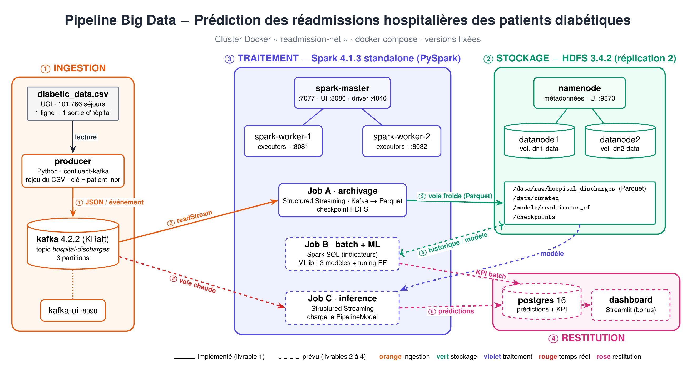
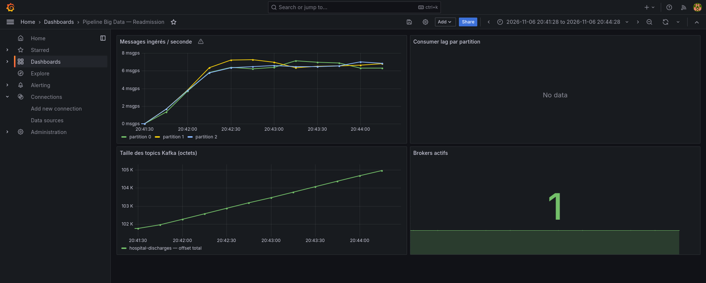
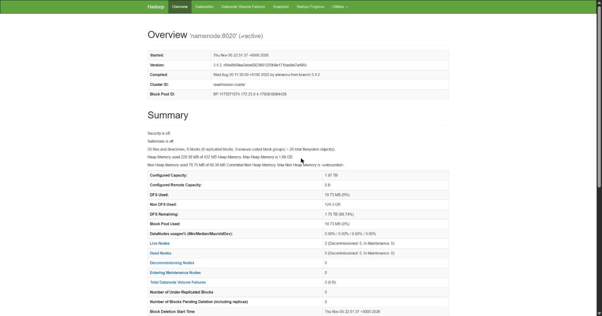
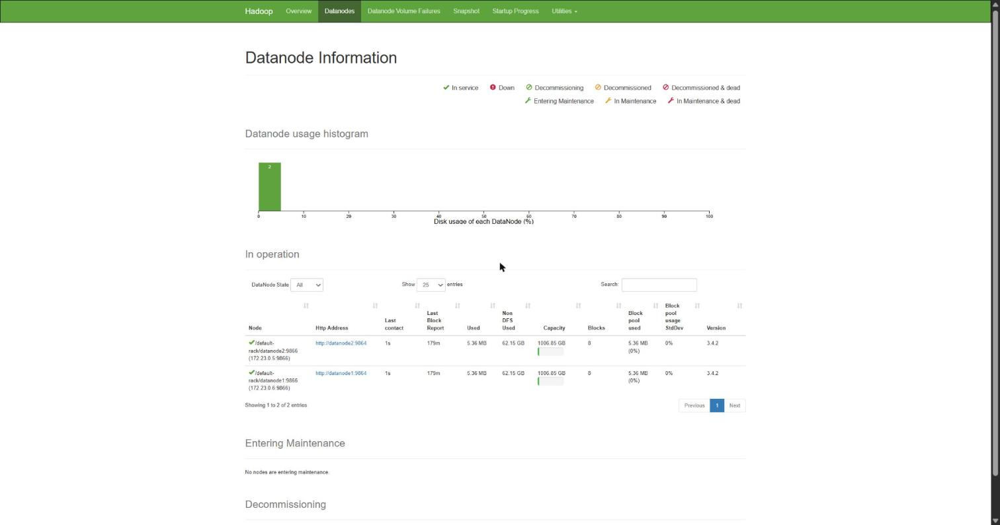
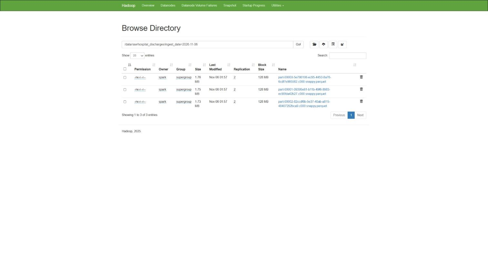
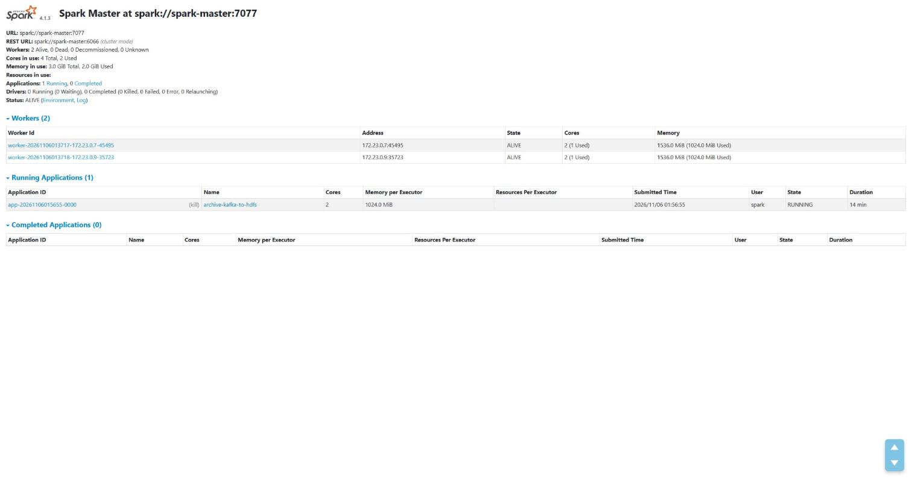
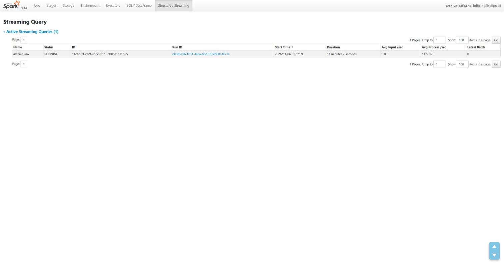
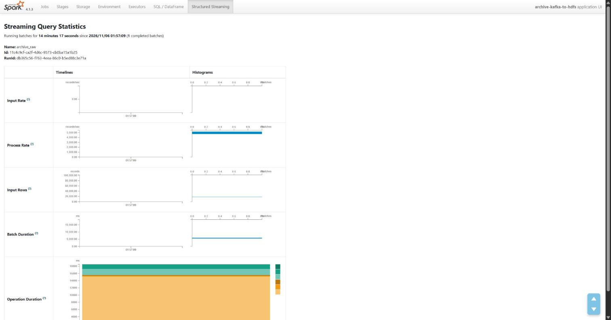
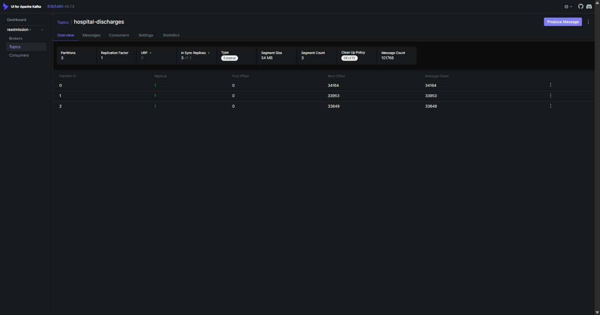
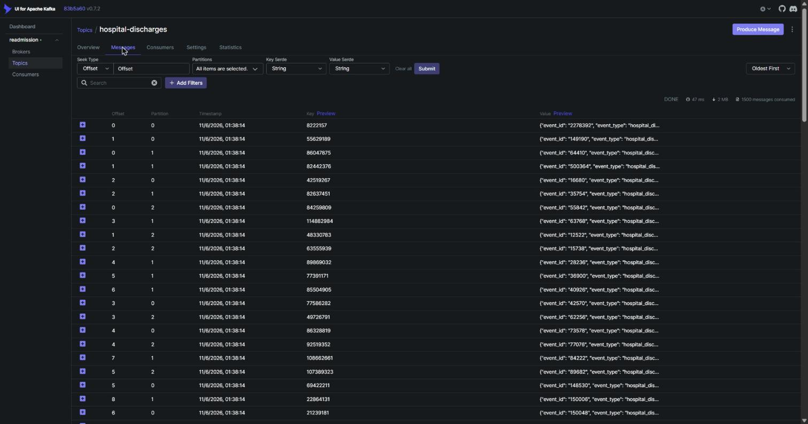

# Prédiction des réadmissions hospitalières des patients diabétiques à l'aide d'une architecture Big Data

Projet **Big Data Plateformes / Big Data Analytics** — ESI Rabat, 3A ISITD, 2026-2027 — encadrante : Pr. El Ghali Btihal.

**Objectif :** à la sortie d'hôpital d'un patient diabétique, prédire s'il sera **réhospitalisé dans les 30 jours**.
**Tâche ML :** classification binaire (Random Forest de Spark MLlib, comparée à deux autres techniques).
**Données :** *Diabetes 130-US Hospitals for Years 1999–2008* (UCI, 101 766 séjours, licence CC BY 4.0).



## État d'avancement

| Livrable | Contenu | État |
|---|---|---|
| **1** | Cluster Docker, figure d'architecture, couche d'ingestion Kafka (+ archivage HDFS) | ✅ ce dépôt |
| 2 | Kafka → Spark → HDFS → indicateurs batch (Spark SQL) | à venir |
| 3 | Pipeline ML (3 modèles, tuning du Random Forest), modèle versionné | à venir |
| 4 | Inférence Structured Streaming → PostgreSQL → tableau de bord | à venir |

## Services du cluster

| Conteneur | Image (version fixée) | Rôle | Accès hôte |
|---|---|---|---|
| `namenode` | `apache/hadoop:3.4.2` | NameNode HDFS (métadonnées) | http://localhost:9870 |
| `datanode1`, `datanode2` | `apache/hadoop:3.4.2` | DataNodes, **réplication 2**, volumes distincts | — |
| `spark-master` | `apache/spark:4.1.3` (+ numpy) | Master Spark standalone, soumission des jobs | http://localhost:8080 · :4040 |
| `spark-worker-1`, `spark-worker-2` | idem | Workers (executors) | http://localhost:18081 · :18082 |
| `kafka` | `apache/kafka:4.2.2` | Broker Kafka en mode KRaft (sans ZooKeeper) | `localhost:29092` |
| `kafka-init` | `apache/kafka:4.2.2` | Crée le topic `hospital-discharges` (3 partitions) puis s'arrête | — |
| `kafka-ui` | `provectuslabs/kafka-ui:v0.7.2` | Interface d'observation des topics et messages | http://localhost:8090 |
| `producer` | `python:3.11.11-slim` + `confluent-kafka 2.6.1` | Rejoue le CSV dans Kafka (profil `ingestion`) | — |
| `postgres` | `postgres:16.6-alpine` | Base de restitution (profil `restitution`, livrable 4) | :5432 |
| `kafka-exporter` | `danielqsj/kafka-exporter:latest` | Exporte les métriques Kafka vers Prometheus (profil `monitoring`) | :9308 |
| `prometheus` | `prom/prometheus:v2.52.0` | Collecte et stocke les métriques (profil `monitoring`) | http://localhost:9090 |
| `grafana` | `grafana/grafana:10.4.3` | Tableau de bord de supervision (profil `monitoring`) | http://localhost:3000 |

## Prérequis

- Docker Desktop (Windows / macOS) ou Docker Engine + Compose v2.24 ou plus récent.
- **8 Go de RAM** alloués à Docker, 4 cœurs, environ 6 Go de disque.
- Ports libres : 9870, 8080, 18081, 18082, 8090, 4040, 29092 (tous modifiables dans `.env`). Arrêtez d'abord les clusters des TP précédents (`docker stop hadoop-master hadoop-slave1 hadoop-slave2`).

## Lancement pas à pas

> **Raccourci :** `powershell -ExecutionPolicy Bypass -File scripts\demo_livrable1.ps1` enchaîne toutes les étapes ci-dessous et termine par la vérification.

Les commandes sont à lancer **depuis la racine du dépôt** (PowerShell sous Windows ; les scripts `.sh` sont les équivalents Linux).

```powershell
# 0. Configuration (aucun secret n'est commité)
Copy-Item .env.example .env

# 1. Télécharger le dataset UCI dans ./data
powershell -ExecutionPolicy Bypass -File scripts\download_dataset.ps1

# 2. Démarrer le cluster : HDFS (1+2), Spark (1+2), Kafka, Kafka UI ; le topic est créé automatiquement
docker compose build spark-master
docker compose up -d
docker compose ps

# 3. Lancer l'archivage Kafka -> HDFS (job Spark Structured Streaming sur le cluster)
powershell -ExecutionPolicy Bypass -File scripts\start_archive.ps1

# 4. Lancer l'ingestion : le producteur rejoue le CSV dans Kafka (20 événements/s par défaut)
docker compose --profile ingestion up -d producer
docker compose logs -f producer          # Ctrl+C pour quitter le suivi

# 5. Vérifier toute la chaîne (écrit aussi docs\verification_livrable1.txt)
powershell -ExecutionPolicy Bypass -File scripts\verify_livrable1.ps1
```

**Réglages utiles du producteur** (dans `.env`) :
- `EVENTS_PER_SECOND=0` : rejeu à vitesse maximale ;
- `MAX_EVENTS=5000` : n'envoie que les 5 000 premiers séjours ;
- `LOOP=true` : flux continu, le fichier est rejoué en boucle.

**Arrêt :**
- `docker compose --profile ingestion down` arrête les conteneurs et **conserve les données** (volumes HDFS et Kafka).
- Ajouter `-v` repart de zéro, car les volumes sont alors supprimés.

## La couche d'ingestion (livrable 1)

1. **Producteur** (`ingestion/producer.py`) : lit `diabetic_data.csv` et publie **un événement JSON par sortie d'hôpital** dans le topic `hospital-discharges`.
   - **Clé du message :** `patient_nbr`. Les séjours d'un même patient vont donc dans la même partition, et leur ordre est conservé.
   - **Livraison fiable :** `acks=all` et producteur idempotent, donc pas de doublon en cas de nouvel essai.
   - **Contenu :** chaque événement contient `event_id` (= `encounter_id`), un horodatage `event_time` (UTC), un numéro d'ordre `seq` et les 50 colonnes du séjour, typées, avec les `?` remplacés par `null`.
2. **Topic Kafka** : `hospital-discharges`, 3 partitions, rétention 7 jours, créé par `kafka-init`.
3. **Archivage (voie froide)** (`streaming/archive_to_hdfs.py`) : job Spark Structured Streaming exécuté sur le cluster Spark.
   - **Source :** Kafka, conformément à la fiche.
   - **Sortie :** Parquet dans `hdfs://namenode:8020/data/raw/hospital_discharges`, partitionné par `ingest_date`.
   - **Reprise :** le checkpoint est stocké dans HDFS, ce qui permet de reprendre exactement là où le job s'était arrêté.

La cible `readmitted` voyage dans l'événement **uniquement** pour l'entraînement et l'évaluation : elle n'est connue que 30 jours après la sortie et **n'est jamais utilisée comme variable explicative** (voir [docs/donnees.md](docs/donnees.md)).

## Supervision (monitoring)

Le profil `monitoring` démarre une stack Prometheus + Grafana + kafka-exporter :

```bash
docker compose --profile monitoring up -d
```

Grafana est accessible sur **http://localhost:3000** (identifiants : `admin` / `admin`).  
Le tableau de bord **Pipeline Big Data — Readmission** s'ouvre via Dashboards → Browse.

| Panneau | Métrique |
|---|---|
| Messages ingérés / seconde | Débit par partition Kafka (rate d'offset) |
| Taille des topics Kafka | Offset cumulé du topic `hospital-discharges` |
| Brokers actifs | Nombre de brokers Kafka vivants |
| Consumer lag par partition | Retard des consommateurs (si consumer group actif) |



## Preuves d'exécution (livrable 1)

Captures prises sur le cluster en fonctionnement, après l'envoi du dataset complet (101 766 événements). Le détail des vérifications en ligne de commande est dans [docs/verification_livrable1.txt](docs/verification_livrable1.txt).

| | Ce que montre la capture |
|---|---|
|  | **HDFS – NameNode** (localhost:9870) : cluster actif, 2 DataNodes vivants. |
|  | **HDFS – DataNodes** : `datanode1` et `datanode2` *In Service*. |
|  | **HDFS – archive brute** : fichiers Parquet dans `/data/raw/hospital_discharges/ingest_date=…`, réplication 2. |
|  | **Spark master** (localhost:8080) : 2 workers ALIVE, application `archive-kafka-to-hdfs` RUNNING. |
|  | **Structured Streaming** (localhost:4040) : requête `archive_raw` active. |
|  | **Statistiques de la requête** : débit d'entrée et durée des micro-batchs. |
|  | **Kafka UI** (localhost:8090) : topic `hospital-discharges`, 3 partitions, 101 766 messages. |
|  | **Kafka UI – messages** : événements JSON, clé `patient_nbr`. |

## Organisation du dépôt

```
├── docker-compose.yml        # cluster complet, versions fixées
├── .env.example              # paramètres (copier en .env)
├── infra/
│   ├── hadoop/               # core-site.xml, hdfs-site.xml (réplication 2)
│   └── spark/                # Dockerfile Spark + spark-defaults.conf (connecteur Kafka)
├── ingestion/                # producteur Kafka (Dockerfile, producer.py, schema.py)
├── streaming/                # jobs Structured Streaming (archivage ; inférence au livrable 4)
├── batch/                    # indicateurs Spark SQL + entraînement MLlib (livrables 2-3)
├── dashboard/                # tableau de bord (livrable 4, bonus)
├── scripts/                  # téléchargement, lancement, vérification
├── data/                     # dataset (non versionné)
└── docs/                     # architecture, documentation des données
```

## Équipe et contributions (livrable 1)

| Étudiant | Contribution |
|---|---|
| BENRBIB Aymen | Cluster Docker (HDFS : 1 NameNode + 2 DataNodes, réplication 2 ; Spark : 1 master + 2 workers ; Kafka KRaft + Kafka UI), producteur Kafka (`ingestion/`), archivage Kafka → HDFS en Parquet avec Spark Structured Streaming (`streaming/`), figure d'architecture, scripts de lancement et de vérification, captures d'exécution |
| AMIRACHE Zaid | Vérification PySpark du pipeline L1 (`data/verify_output.py`, rapport [docs/verification_output_livrable1.md](docs/verification_output_livrable1.md)), supervision Prometheus + Grafana (profil `monitoring`, `infra/prometheus/`, `infra/grafana/`) |
| ZIANE Marya | Tests de résilience : reprise du job Spark après arrêt (checkpoint) et panne d'un DataNode (`docs/tests_resilience.md`, en cours) |
| KARAM Ines || KARAM Ines | Justification des choix techniques ([docs/choix_techniques.md](docs/choix_techniques.md)) ; fiabilité de l’ingestion : DLQ, healthcheck et runbook ||
